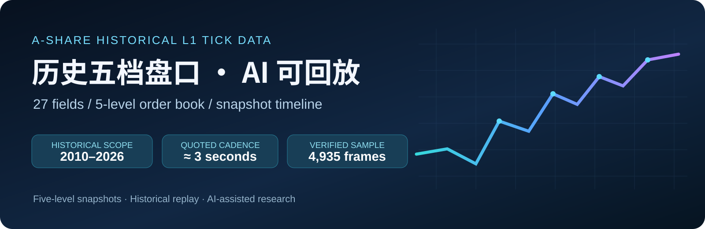
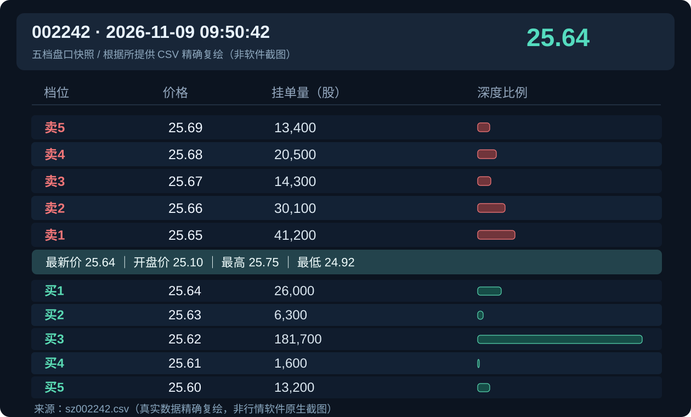

<a href="./README.md"><b>简体中文</b></a> ｜ <a href="./README_EN.md">English</a>

<h1 align="center">A 股 L1 全天 Tick · 历史五档盘口数据</h1>

<b>不是一张 K 线，而是让过去每个快照时刻的买卖五档重新呈现在眼前。</b>

<a href="#看见历史盘口">看见历史盘口</a> · <a href="#一份真实数据的核验">实测证据</a> · <a href="#如何让-ai-回放历史五档">AI 回放</a> · <a href="#数据范围与交付">数据规格</a> · <a href="#获取与联系">联系</a>

---

## 看见历史盘口

普通日线告诉你一天涨跌多少，分钟线告诉你价格怎么走。**L1 全天 Tick 五档数据**，则可以进一步展示：某个历史时刻，**买一到买五、卖一到卖五的价格与挂单量是什么**，盘口怎样从上一帧变化到下一帧。

<blockquote>
例如问 AI：<b>“把 2026 年 11 月 9 日九阳股份 002242 的五档盘口从 09:50:30 回放到 09:51:03，并标出买卖一档量的变化。”</b>
</blockquote>

这不是让 AI 猜过去的盘口，而是**读取真实 CSV → 按时间定位 → 还原已有五档快照 → 可视化播放与分析**。

| 快照中能看到 | 能帮助解决的问题 |
|---|---|
| 买卖一至五档的价格与委托量 | 当时盘口深度、买卖盘对比、档位变化 |
| 最新价、开盘价、最高价、最低价 | 价格变动与盘口的同步观察 |
| 累计成交量、累计成交额 | 盘中成交进展、累计指标随时间变化 |
| 时间戳 | 指定时间定位、历史回放、跨时点对比 |

**边界很重要：** L1 保存的是离散的五档盘口快照；它**不是逐笔委托、逐笔成交明细**，不能凭空推断快照之间发生的每笔挂撤单，也不能声称从中无损重建完整委托队列。

## 一份真实数据的核验

本仓库依据上传的 **九阳股份 \`002242\` / \`2026-11-09\`** CSV 和对应同花顺盘口截图制作。原 CSV 在本地实际检查结果如下：

| 验证项 | 实际结果 |
|---|---:|
| 文件 | \`sz002242.csv\` |
| 时间范围 | \`09:15:00 – 15:30:00\` |
| 原始记录数 | **4,935 条** |
| 字段 | **27 列** |
| 相邻 3 秒的快照间隔 | **4,742 / 4,934（约 96.1%）** |
| 指定核验时刻 | **09:50:42** |

**这帧的盘口不是模拟数据：**

| 档位 | 价格（元） | 挂单量（股） |
|---|---:|---:|
| 卖一 | **25.65** | **41,200** |
| 买一 | **25.64** | **26,000** |
| 卖二 | 25.66 | 30,100 |
| 买二 | 25.63 | 6,300 |
| 卖三 | 25.67 | 14,300 |
| 买三 | 25.62 | 181,700 |

同期最新价 **25.64 元**、累计成交量 **23,813,857 股**、累计成交额 **605,350,735.91 元**。这些数值能从原 CSV 中读取，也与用户提供的对照图中相应项目一致。

上图由真实 CSV 数值复绘，非行情软件截图；公开的是少量截取样本，不是整日商品数据。

👉 [查看真实样本说明](./docs/SAMPLES.md) · [打开少量 CSV 样本](./samples/002242_20261109_excerpt.csv) · [查看全部 27 个字段](./docs/FIELDS.md)

## 如何让 AI 回放历史五档

有了 CSV，就可以让 AI 辅助完成**时间定位、五档显示、前后帧对比、交互式回放页面与分析**。

~~~mermaid
flowchart LR
    A[指定日期和股票] --> B[读取当天 L1 CSV]
    B --> C[校验 27 列和时间顺序]
    C --> D[按时间索引五档快照]
    D --> E[盘口阶梯 / 深度条 / 时间滑块]
    E --> F[AI 解读变化和生成研究报告]
~~~

**不用先搭复杂平台，也可以做演示：**

~~~bash
python examples/l1_replay.py --csv samples/002242_20261109_excerpt.csv --out replay.html
~~~

运行后打开 \`replay.html\`，即可通过滑块逐帧切换、播放买卖五档（本例仅用公开截取样本）。示例代码使用 Python 标准库，**没有声称已接入实时数据、MCP 或自动化 AI Agent**。

AI 使用提示词和实施边界：[docs/AI_REPLAY.md](./docs/AI_REPLAY.md)。

## 数据范围与交付

下表**“商品说明口径”来自提供的销售资料**；目前只抽样核验了 \`002242 / 2026-11-09\`，并未逐年逐日审计全量历史。

| 项目 | 商品说明口径 |
|---|---|
| 交易所 | **沪深两市 A 股**；不含北交所 |
| 历史范围 | **2010–2026 年** |
| 每只证券每天 | 一个 CSV 文件 |
| 字段 | **27 列**（时间 + OHLC / 最新价 + 累计量额 + 买卖五档价量） |
| 推送节奏 | 活跃阶段通常约 **3 秒一帧**，冷门股或特殊交易阶段会有不等间隔 |
| 盘中时间 | 包含 **09:15** 集合竞价、连续竞价、收盘集合竞价 |
| 盘后数据 | 有对应制度且实际有记录的证券，可延伸到 **15:30** |
| 包装与规模 | 按日压缩包；近年单日全量约 **600 MB**；2010–2026 全套约 **1.4 TB** |

**盘后固定价格交易不是所有年份、所有板块都有。** 科创板、创业板在对应制度实施后才有相关历史；2026 年 7 月 6 日起盘后固定价格交易适用范围扩展至沪深全部 A 股与 ETF，具体以对应交易所规则及实际数据为准。参考：[上交所 2026 年交易规则](https://www.sse.com.cn/lawandrules/sselawsrules2025/fund/trading/c/c_20260424_10817739.shtml)。

### 这套数据适合什么场景？

- **历史五档盘口回放**：复现某时点买卖档位与数量；
- **盘口研究**：买卖盘量差、五档深度、买卖价差、档位迁移；
- **AI 数据分析**：让 AI 读 CSV、写可视化、生成初步研究报告；
- **量化特征研究**：构建基于 L1 快照的统计特征；
- **教学与复盘**：展示 K 线难以表达的盘口状态变化。

## 文档与样本

| 入口 | 介绍 |
|---|---|
| [字段字典 / FIELDS](./docs/FIELDS.md) | 27 列字段、类型、单位、五档价量说明 |
| [真实样本 / SAMPLES](./docs/SAMPLES.md) | 4,935 行原样本核验、09:50:42 逐项对比 |
| [AI 回放教程 / AI_REPLAY](./docs/AI_REPLAY.md) | 提示词、操作方式、示例程序与正确技术边界 |
| [常见问题 / FAQ](./docs/FAQ.md) | 更新频率、年份/容量口径、盘后交易、L1/L2 差异 |
| [English README](./README_EN.md) | 英文产品简介 |

## 获取与联系

**QQ：2565473796**，添加好友时请注明 **“GitHub · L1 全天 Tick / 历史五档”**。

**公众号：代码炒家阿凯**，欢迎关注 A 股数据、AI 应用与量化相关内容。

<table>
<tr>
<td align="center"> <b>QQ：2565473796</b></td>
<td align="center"> <b>公众号：代码炒家阿凯</b></td>
</tr>
</table>

## 公开范围与免责声明

本仓库用于**产品介绍、字段说明、实测示例与教育性回放演示**。不公开全量商品数据、采集/清洗内部逻辑、账号密钥、商业授权信息。示例程序只处理用户自行合法取得的 CSV。历史行情不代表未来，内容不构成投资建议；数据用途和授权范围以实际交付约定为准。
