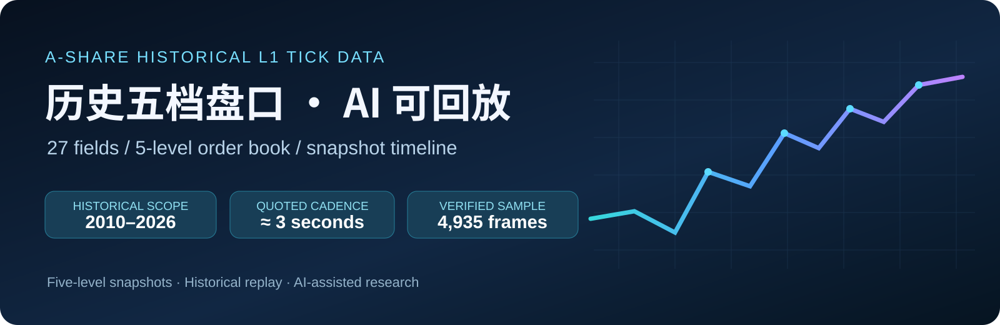
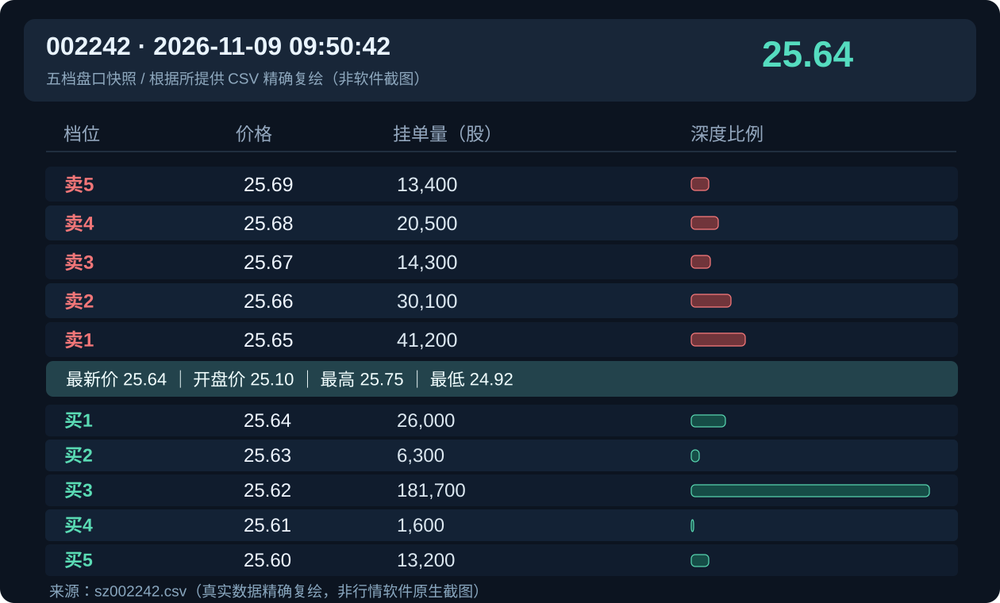

<a href="./README.md">简体中文</a> ｜ <a href="./README_EN.md"><b>English</b></a>

# A-Share Historical L1 Tick Data · Five-Level Order Book Snapshots

**Go beyond candles:** inspect historical bid/ask prices and displayed quantities at levels 1–5, frame by frame.

## What you can do

This product introduces historical **L1 market snapshots** covering the best five bid and ask levels, along with latest/open/high/low prices, cumulative volume and turnover.

A practical AI request might be:

> "Replay the five-level order book for 002242 on 2026-11-09 from 09:50:30 to 09:51:03. Highlight changes in best bid/ask volume."

An AI assistant can **read the historical CSV, identify timestamps, render stored snapshots, and analyze changes**. This is replay of recorded data, **not** reconstruction of all order events between snapshots.

## Verified sample: 002242, 2026-11-09

The supplied source file was actually inspected:

| Metric | Observed |
|---|---:|
| CSV columns | **27** |
| Records | **4,935** |
| Time span | **09:15:00–15:30:00** |
| Consecutive 3-second intervals | **4,742 of 4,934** |
| Verified time | **09:50:42** |

At that time, the best ask was **CNY 25.65 / 41,200 shares**, and the best bid was **CNY 25.64 / 26,000 shares**. Latest price was **CNY 25.64**. Those values match the provided comparison image.

This is a **CSV-grounded rendering**, not a native trading-platform screenshot. Only small, selected rows are publicly provided.

## Get started with the standalone replay example

~~~bash
python examples/l1_replay.py --csv samples/002242_20261109_excerpt.csv --out replay.html
~~~

Open \`replay.html\` locally and inspect the time-slider replay. No third-party Python packages required.

The example is **not an AI agent, not a live data feed, and not a production MCP server**. AI can assist with the downstream workflow using this historical data.

Read [AI replay use cases](./docs/AI_REPLAY.md), [field reference](./docs/FIELDS.md), [sample verification](./docs/SAMPLES.md), and [FAQ](./docs/FAQ.md).

## Product scope (seller-provided; not independently audited in full)

| Property | Product material |
|---|---|
| Market | Shanghai and Shenzhen A-shares (excludes Beijing Stock Exchange) |
| Historical range | 2010–2026 |
| Data structure | One CSV per symbol per trading day, 27 columns |
| Quoted snapshot cadence | Around 3 seconds in active trading; actual intervals vary |
| Daily packaging | One compressed archive per trading day |
| Approximate historical archive size | ~1.4 TB |
| Typical recent full-market daily archive | ~600 MB |

**Trading sessions differ by exchange, board and date.** Post-close fixed-price trading is only relevant when supported by the rules in force and by the actual market data. The July 6, 2026 expansion covered all Shanghai/Shenzhen A-shares and ETFs under the revised rules ([SSE rules](https://www.sse.com.cn/lawandrules/sselawsrules2025/fund/trading/c/c_20260424_10817739.shtml)).

## Contact

**QQ:** 2565473796 — please mention **GitHub L1 Tick**.  
**WeChat Official Account:** 代码炒家阿凯

<table><tr><td align="center"> QQ</td><td align="center"> 代码炒家阿凯</td></tr></table>

This repository is for product presentation, limited sample inspection and educational replay. No full commercial archive or confidential implementation is published. It does not provide investment advice.
